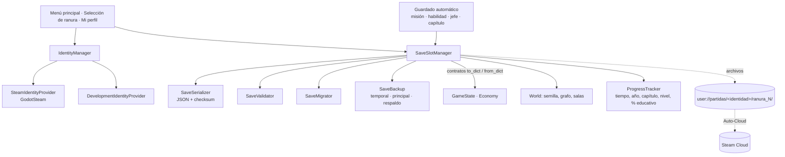

# Sistema de usuarios, perfiles y partidas (Steam)

**Estado:** Fase 1 aprobada. **T1–T8 y T11 hechas** (13 de octubre de 2026): identidad de desarrollo, formato v2
con migración, 3 ranuras con escritura segura, persistencia del mapa y del progreso, guardado automático, el menú
con la selección de partida, «Mi perfil», la carpeta propia `%APPDATA%\Nullveil` y el endurecimiento. Faltan T9
(GodotSteam, pide permiso de descarga) y T10 (Steamworks, pide acceso) (sección 14).
**Fecha:** 13 de octubre de 2026. **Motor:** Godot 4.7.2 (GDScript). **Plataforma:** Steam para PC (Windows).

## 0. Decisión de plataforma

- Solo **Steam para PC**. Android queda pospuesto.
- **Steam gestiona la identidad.** No hay registro con correo ni contraseña, ni backend propio ni base de datos
  central, ni cuentas multiplataforma.
- El juego corre **localmente y sin conexión** (si la licencia lo permite). **Steam Cloud (Auto-Cloud)** sincroniza
  las partidas entre computadoras cuando está configurado y habilitado.

Esto **reemplaza** la idea de cuentas con servidor propio que se exploró el 13 de octubre (nunca se subió a `main`;
ver la sección 13).

## 1. Lo que ya existe en el repositorio (revisión)

| Sistema | Dónde | Qué guarda o hace hoy | Qué cambia |
|---|---|---|---|
| Guardado | `autoload/save_manager.gd` | **Una sola partida** (`user://partida.json`): `{version, saved_at, location{scene, entry}, game}`. Escritura con temporal → verificación → el anterior pasa a `.respaldo.json`. Lee la copia si la principal está dañada. `VERSION = 1`, `_migrate()` mínima | Pasa a **3 ranuras por identidad**, sobre con secciones, checksum, migración y revisiones. Se conserva la estrategia de escritura |
| Progreso | `autoload/game_state.gd` | `to_dict()/from_dict()`: misiones (`quests`, `active_quest`), marcas (`flags`), decisiones, incidentes, pistas, comandos aprendidos, huellas de contraseñas del juego, jugador (cristales, fragmentos de vida/energía, energía, dash, doble salto, pared, Visión, `nullblade_stage`, `aegis_stage`, `domain_stage`) y la economía | Se le agregan tiempo jugado y año/capítulo/nivel (o los calcula `ProgressTracker`) |
| Economía | `autoload/economy.gd` | `{ecos, claimed}`: las recompensas cobradas (`claim_reward`/`claim_drop`) evitan duplicados | Sin cambios: ya separa por ranura si se reinicia antes de cargar |
| Mapa | `autoload/world.gd`, `systems/world/` | Grafo fijo por distrito (`DistrictLayout` → `RoomGraph`, con `to_dict/from_dict`). **No hay generador ni semilla todavía (M4)** | Se guarda la sección `mundo` desde ya (versión del generador, semilla, grafo, salas visitadas) |
| Puntos de guardado | `world/digital/save_point.gd`, `restore_point.gd`, `Room.checkpoint` | Computadora segura (E: guarda y cura) y puntos de control | Pasan a usar la ranura activa |
| Grimorio | `systems/grimorio/`, `ui/menus/grimorio/` (inventario de Ariel) | Las páginas se desbloquean por marcas, misiones, propiedades y comandos de `GameState` | Sin cambios: se guardan sus fuentes |
| Escenas | `autoload/scene_manager.gd` | `go_to_room(escena, entrada, room_id)` con fundido | Se usa para cargar; da el «no guardar durante una transición» |
| Menú | `ui/menus/main_menu/` | CONTINUAR / INICIAR / OPCIONES / CRÉDITOS / SALIR | Continuar, Nueva partida, Cargar, Mi perfil, Opciones, (Créditos), Salir |
| Opciones | `systems/settings/game_settings.gd` → `user://ajustes.cfg` | Del dispositivo | Siguen siendo del dispositivo (no se sincronizan) |

**Autoloads actuales:** SceneManager, GameState, DigitalVision, Economy, SaveManager, World.
**Biblia Narrativa:** consultada. Los años (décimo, undécimo, duodécimo), los capítulos y niveles, Nullblade (4
etapas), Aegis (3 evoluciones + Salto de Nexo) y Dominio Nulo coinciden con la sección 7. **No aparecen en la
Biblia:** «Inmersión Digital», la persecución del capítulo 1 ni el «Jefe Chip y Glitch» (ver riesgos).

## 2. Arquitectura



| Componente | Tipo | Responsabilidad |
|---|---|---|
| **IdentityManager** | Autoload (se necesita antes del menú y en todo el juego) | Elige el proveedor, expone `identity_id` (para rutas), `display_name`, `kind` ("steam" / "dev") y si Steam está disponible |
| **SteamIdentityProvider** | Clase | Inicia Steamworks (GodotSteam), lee el Steam ID de 64 bits y el nombre público. Métodos exactos: **se verifican con la API instalada** |
| **DevelopmentIdentityProvider** | Clase | Identidad local de prueba `dev-<código al azar>` guardada en el dispositivo. Nunca parece un Steam ID |
| **SaveSlotManager** | Evolución de `SaveManager` (autoload existente) | 3 ranuras por identidad: crear, cargar, guardar, borrar, resúmenes, estado de integridad, recuperar respaldo |
| **SaveSerializer** | Clase estática | Sobre → texto JSON canónico y checksum SHA-256; nunca objetos de Godot ni `str_to_var` |
| **SaveValidator** | Clase estática | Tipos, rangos, ids conocidos, rutas de escena permitidas (solo `res://world/zones/…` existentes) |
| **SaveMigrator** | Clase estática | Cadena de migraciones `v1 → v2 → …`; copia el archivo antes de migrar |
| **SaveBackup** | Parte de SaveSlotManager | Escritura segura y rotación de copias (sección 6) |
| **ProgressTracker** | Clase (lo usa GameState) | Tiempo jugado, año/capítulo/nivel, % de historia y % educativo, a partir de las misiones |
| **SteamCloudAdapter** | Documentación + consulta opcional | Configuración de Auto-Cloud; solo informa «nube habilitada» si Steam lo confirma |

No se crea un gestor gigante: cada sistema entrega su estado con `to_dict()` / `from_dict()` (contrato que ya usan
GameState, Economy y RoomGraph).

## 3. Identidad

- **Steam:** al arrancar, si GodotSteam está disponible y Steam inicia bien, `identity_id = "steam_<SteamID64>"` y
  `display_name` = nombre público (solo para mostrar; **nunca** como clave de carpeta).
- **Desarrollo (desde el editor o sin Steam):** `identity_id = "dev_<16 hex al azar>"`, guardado en
  `user://identidad_desarrollo.cfg` (no se sincroniza). Nombre visible: «Desarrollo (sin Steam)». El prefijo `dev_`
  hace imposible confundirla con una de Steam. No se inventa un Steam ID.
- **Varias personas en una PC:** cada identidad tiene su carpeta; el juego solo lista y carga las ranuras de la
  identidad activa. Al cambiar de usuario de Steam, cambia la carpeta.
- **No se guardan** contraseñas, tickets de sesión ni secretos de Steamworks. El Steam ID local **no** se usa como
  prueba de identidad ante servicios remotos (si alguna vez hay rankings, se diseñan aparte con tickets de sesión
  verificados por un servidor).
- **Si Steam no está disponible** en una versión publicada: se avisa «Steam no disponible» y el juego usa la
  identidad de la última sesión de Steam en ese dispositivo (solo lectura de su carpeta) o no permite guardar; a
  decidir (sección 12).

## 4. Carpetas

```
user://  = %APPDATA%\Nullveil          (carpeta propia desde T11; antes Godot/app_userdata/…, se copia sola)
├── ajustes.cfg                          opciones del dispositivo (no se sincroniza)
├── identidad_desarrollo.cfg             solo modo desarrollo (no se sincroniza)
└── partidas/
    ├── <SteamID64>/                     ← lo que sincroniza Auto-Cloud ({64BitSteamID})
    │   ├── ranura_1/
    │   │   ├── partida.sav              principal
    │   │   ├── partida.respaldo.sav     la anterior válida
    │   │   └── partida.sav.tmp          temporal (no coincide con el patrón: no se sincroniza)
    │   ├── ranura_2/ …  ranura_3/ …
    │   └── registro_local.dat           revisiones vistas en ESTE equipo (no se sincroniza)
    └── dev_<código>/ …                  modo desarrollo (fuera del patrón de la nube)
```

La carpeta de Steam es solo el número (`partidas/<SteamID64>`) para que coincida con la variable `{64BitSteamID}`
de Auto-Cloud; la de desarrollo lleva el prefijo `dev_`.

## 5. Formato de guardado (versión 2)

JSON en texto (legible, fácil de validar y de migrar; la partida pesa pocos KB). Sin serialización de objetos.

```json
{
  "formato": "nullveil-partida",
  "save_version": 2,
  "meta": {
    "ranura": 1, "partida_id": "9f2c…(128 bits al azar)", "revision": 42,
    "guardada": 1760371200, "tiempo_jugado": 2903, "version_juego": "0.1.0",
    "anio": "decimo", "capitulo": 1, "nivel": 1, "lugar": "Laboratorio del colegio",
    "integridad": "sha256 de las secciones"
  },
  "ubicacion": { "escena": "res://world/zones/zone0/laboratorio.tscn", "punto": "entrada", "sala": "laboratorio" },
  "estado": { "...": "GameState.to_dict() (incluye economía, comandos, marcas, misiones, habilidades)" },
  "mundo": { "generador": 1, "semilla": 0, "distritos": { "colegio": "RoomGraph.to_dict()" },
             "salas": { "visitadas": [], "descubiertas": [] }, "puertas_abiertas": [], "objetos": [] },
  "educativo": { "temas": [], "desafios": [], "preguntas": [], "paginas": [] }
}
```

- **Metadatos, estado jugable y estado del mundo** van en secciones separadas del mismo archivo: se escriben
  juntos, así nunca quedan desparejos. Las **opciones del dispositivo** van aparte (`ajustes.cfg`).
- **`integridad`** detecta archivos dañados o editados a medias; **no** impide que alguien los modifique a propósito
  (los archivos locales siempre se pueden alterar).
- **Restaurar con cuidado:** cada campo se valida (tipo y rango); ids desconocidos se ignoran sin borrar el resto;
  las escenas solo pueden ser salas del juego que existan.
- **Política de recursos al cargar:** Kai aparece en el último punto de guardado o de control con **cristales y
  energía llenos** (como un banco de Hollow Knight). No se restaura la vida exacta del momento.
- **Habilidades:** se restauran tal como estaban guardadas; nunca se otorga algo que no figure en la partida.
- **Duplicados:** las recompensas únicas ya se registran en `Economy.claimed` y en marcas: recargar no las repite.

## 6. Escritura segura y respaldos

Lo verificado en el código de Godot (`drivers/windows/dir_access_windows.cpp`): en Windows, `DirAccess.rename`
**borra primero el destino y después llama a `MoveFileW`**; no es un reemplazo atómico. `FileAccess.close()`
vacía el búfer al sistema operativo, pero **no garantiza** que llegue al disco ante un corte de luz.

Por eso, la estrategia asegura que **siempre exista al menos una copia válida**:

1. Se arma una instantánea consistente y se valida.
2. Se escribe `partida.sav.tmp` y se cierra.
3. Se vuelve a leer `partida.sav.tmp` y se valida (JSON, versión, integridad).
4. Se borra el respaldo viejo y la principal pasa a ser `partida.respaldo.sav` (rename).
5. El temporal pasa a ser `partida.sav` (rename).

Al cargar (también tras un cierre inesperado): se usa la principal si es válida; si no, el **temporal** si es válido
y su revisión es mayor (el corte fue entre 4 y 5); si no, el **respaldo**. Lo usado y lo descartado se informa en la
tarjeta de la ranura («recuperada desde el respaldo»). Antes de migrar se guarda una copia
`partida.v<N>.sav`. Cada ranura es independiente: un error nunca toca las otras dos.

## 7. Cuándo se guarda

- **Automático** (si es seguro): al completar una misión o un paso importante, al pasar un punto de control
  importante, al obtener una habilidad, al terminar un jefe, al cambiar de capítulo, al cobrar una recompensa única
  y al salir por el menú.
- **Manual:** en las computadoras seguras.
- **«Es seguro guardar»** solo si: Kai está en el suelo y vivo, no está cayendo ni reapareciendo, no hay
  transición de escena (`SceneManager`), ni diálogo, ni cinemática, ni ataque en curso. Si no es seguro, el
  guardado espera hasta que lo sea. Siempre se guarda **la posición del último punto válido**, no la exacta.
- **Persecución del capítulo 1:** se guarda solo el último punto de control completado; al cargar, la persecución
  reinicia desde ahí con el tiempo completo del tramo (no se guardan la barrera ni el temporizador a medias).

## 8. Steam Cloud (Auto-Cloud)

Primera opción: **Auto-Cloud** (sin código). Configuración en Steamworks (a hacer por el equipo):

| Campo | Valor propuesto |
|---|---|
| Root | `WinAppDataRoaming` |
| Subdirectory | `Nullveil/partidas/{64BitSteamID}` (carpeta propia activa desde T11) |
| Pattern | `*.sav` (principal y respaldo; el temporal `.tmp`, el registro local `.dat`, los logs y las opciones quedan fuera) |
| Recursive | Sí (las 3 ranuras) |
| Cuota | 3 ranuras × 2 archivos ≈ 6 archivos, unos pocos MB en total (ajustar con los tamaños medidos) |

Según la documentación de Valve, Steam sincroniza **al abrir y al cerrar** el juego, y `{64BitSteamID}` separa los
archivos por usuario. **No se afirma que funcione hasta probarlo con la aplicación configurada en Steamworks.**

## 9. Conflictos entre computadoras

Cada guardado lleva `partida_id`, `revision` (sube en cada guardado), `tiempo_jugado` y una fecha solo informativa.
Steam puede mostrar su propio aviso de conflicto al abrir el juego (comportamiento a **verificar en las pruebas**).
Dentro del juego, `registro_local.dat` (no se sincroniza) recuerda la última revisión que vio **este** equipo: si
llega desde la nube una partida con revisión menor, o con otro `partida_id` en la misma ranura, la tarjeta muestra
«Posible conflicto» y ofrece elegir (con año, capítulo, tiempo jugado y revisión de cada una), guardando siempre la
otra como respaldo. No se usa solo la fecha del sistema.

## 10. Interfaz

- **Menú principal:** Continuar (la última ranura usada) · Nueva partida · Cargar partida · Mi perfil · Opciones ·
  Créditos · Salir. Abajo, el nombre de Steam (o «Desarrollo (sin Steam)»).
- **Selección de partida:** 3 tarjetas (año, capítulo, nivel, lugar, tiempo jugado, último guardado, estado:
  correcta / recuperada / dañada / posible conflicto). Sobrescribir pide confirmación; borrar pide **doble**
  confirmación.
- **Mi perfil:** nombre de Steam (y avatar si conviene), tiempo total, año, capítulo y nivel, Ecos, habilidades,
  % de historia y % educativo, logros y último guardado. Nada privado de la cuenta.
- **Indicadores:** guardando · guardado · error al guardar · Steam no disponible · posible conflicto. Nunca
  «sincronizado» si Steam no lo confirma.

## 11. Pruebas automáticas (propuestas)

`tests/test_save_slots.gd` y afines, con identidades de desarrollo distintas (sin Steam):
crear 3 partidas y cargar cada una · una ranura no altera otra · Ecos persisten · habilidades (Visión, dash,
Nullblade) se restauran sin adelantos · semilla y grafo del mapa iguales al recargar · recompensas no se duplican ·
guardar tras un jefe · restaurar puntos de control · archivo dañado → respaldo · temporal válido tras «corte»
simulado · migración v1 → v2 (la partida actual de `user://partida.json`) con copia previa · versión futura →
mensaje claro sin borrar nada · dos identidades en una PC no se ven · no guardar en caída / transición / diálogo ·
tamaño y tiempo de guardado medidos. Con Steam (manuales, cuando haya AppID): nombre y Steam ID reales, cambio de
usuario de Steam, sin conexión, Auto-Cloud entre dos PC y conflictos.

## 12. Riesgos y decisiones pendientes

| Riesgo | Propuesta |
|---|---|
| **GodotSteam es un addon (GDExtension)** y la regla del proyecto era «sin plugins» | Pedir una excepción solo para GodotSteam: es la integración mantenida (GDExtension v4.23.1, Steamworks SDK 1.65, «Godot 4.4 y superior»). Se descarga de Codeberg (`godotsteam-4.23.1-gdextension-plugin-4.4.zip.tar.xz`, 17 MiB), con permiso. Antes de usar cualquier método, se verifica la API instalada |
| **Hace falta un AppID propio** (cuenta de Steamworks; Valve cobra una tarifa por juego) | Lo gestiona el equipo. Mientras tanto, todo se desarrolla y se prueba con la identidad de desarrollo |
| `rename` no es atómico en Windows | Estrategia de la sección 6 y prueba de recuperación |
| ~~Carpeta de usuario en `Godot/app_userdata/…`~~ | **Hecho (T11):** carpeta propia `%APPDATA%\Nullveil`; lo existente se copia la primera vez |
| Steam no disponible en una versión publicada | Decidir: permitir jugar con la última identidad conocida (solo su carpeta) o pedir abrir Steam |
| **Capítulo 1 no está en la Biblia** («Inmersión Digital», persecución, «Jefe Chip y Glitch») | Diseñar el guardado genérico (marcas y puntos de control); el contenido narrativo se valida con la Biblia antes de implementarlo |
| Partida actual de Yohann11 en `user://partida.json` | La migración la pasa a la ranura 1 de la primera identidad que abra el juego en ese equipo |
| Conflictos de Auto-Cloud | Verificar el comportamiento real con la aplicación configurada |

## 12 bis. Cómo quedó (T1–T4)

- `autoload/identity_manager.gd` (autoload `IdentityManager`, clase `PlayerIdentity`): elige el proveedor (hoy solo
  el de desarrollo; Steam en T9), `saves_root()` y `is_valid_folder()` (solo dígitos o `dev_` + 16 hexadecimales: un
  id raro nunca escribe fuera de `user://partidas`).
- `systems/identity/`: `IdentityProvider` (base) y `DevelopmentIdentityProvider` (`user://identidad_desarrollo.cfg`).
- `systems/save/`: `SaveSerializer` (cabecera + cuerpo, huella SHA-256 del cuerpo; reconoce la versión 1),
  `SaveValidator` (tipos y rangos; enteros aunque el JSON de Godot los devuelva como decimales) y `SaveMigrator`.
- `autoload/save_manager.gd`: `new_game`, `load_slot`, `continue_game`, `save_game`, `slot_info` (vacía / ok /
  recuperada / dañada / incompatible, y `conflicto`), `delete_slot`, `restore_backup`, `migrate_legacy`, señales
  `saved`, `save_failed` y `slots_changed`. Un archivo de otra ranura copiado a esta se rechaza.
- **La partida de antes** (`user://partida.json`) pasa a la ranura 1 de la primera identidad que abre el juego en el
  equipo, con una copia del original (`ranura_1/partida.v1.json`). En el equipo de desarrollo ya pasó a la identidad
  de desarrollo; cuando llegue Steam (T9) habrá que ofrecer **importar esa ranura** a la identidad de Steam.
- **Menú (provisorio hasta T7):** CONTINUAR abre la última ranura usada; INICIAR empieza en la primera ranura vacía y,
  si las tres están ocupadas, avisa (nunca pisa una partida).
- **Medido:** una partida pesa ~1,4 KB y guardar tarda ~30 ms.
- Prueba: `tests/test_save.gd`.

**T5:**
- `GameState.play_time`: avanza solo dentro de una sala (`Room._process`) y sin pausa; se guarda en el estado y en la
  tarjeta (`tiempo_jugado`).
- `systems/save/progress_tracker.gd` (`ProgressTracker`): año, capítulo y nivel (marcas `capitulo_N` y
  `nivel_N_completado` que dejará el contenido; el prólogo cuenta por sus misiones), % de historia (prólogo + 24
  niveles) y % educativo (terminales y desafíos resueltos sobre los que existen hoy). Van en `meta` (para las
  tarjetas) y en la sección `educativo`.
- `World.to_dict()/from_dict()`: semilla (como texto), versión del generador y salas visitadas. **Política:** los
  distritos fijos se arman siempre con los datos actuales (una actualización puede sumar salas); lo procedural
  (M4) usará la semilla y la versión del generador guardadas, así el mapa de una partida no cambia al actualizar.
- **Política de recursos:** al cargar, Kai aparece en su punto de guardado con cristales y energía llenos.

**T6:** `systems/save/auto_save.gd` (`AutoSave`, hijo de `SaveManager`: `SaveManager.auto_save`).
- **Pide guardar** al avanzar un paso o una misión (señales de `GameState`; el cambio de capítulo llega por una
  misión), al obtener una habilidad o mejora permanente (compara una foto de dash, doble salto, pared, Visión,
  Nullblade, Aegis, Dominio, cristales y energía máximos), al cobrar una recompensa única (señal nueva
  `Economy.reward_claimed`: terminales, desafíos, jefes, fragmentos) y al salir al menú con Esc (`save_now`).
- **Solo si es seguro** (`is_safe()`): ranura activa, sala cargada, Kai vivo y sin reaparecer, en el suelo, con
  control (sin diálogo ni cinemática), sin transición de escena (`SceneManager.is_changing()`), sin pausa y sin nada
  en el grupo **`guardado_bloqueado`** (la pelea de la «Contraseña débil» se agrega mientras dura; la persecución
  del capítulo 1 deberá hacer lo mismo). Si no es seguro, el pedido queda pendiente y se reintenta cada 0,5 s.
- **Punto de reaparición** (`Room.save_point_id()`): la computadora segura activa o la entrada por la que llegó Kai
  (`Room.arrival_entry`); vacío = el punto de aparición de la sala. Nunca la posición exacta.
- Cargar o empezar una partida no dispara guardados (`quiet`). El guardado automático no muestra aviso todavía:
  los indicadores llegan con el menú (T7).
- Prueba: `tests/test_autosave.gd`.

**T7:**
- **Menú principal:** Continuar (la última ranura usada) · Nueva partida · Cargar partida · Opciones · Salir; abajo,
  «Jugador: …» (hoy «Desarrollo (sin Steam)») y Créditos junto a la versión. «Mi perfil» llega con T8.
- **Selección de partida** (`ui/menus/slots/slot_select.gd`, `SlotSelect`): 3 tarjetas con año, capítulo y nivel (o
  «Prólogo»), lugar, tiempo jugado (hh:mm:ss), fecha del último guardado y estado (correcta, recuperada desde el
  respaldo, dañada, de una versión más nueva). Nueva partida en una ranura ocupada pide confirmación; borrar pide
  doble confirmación; una partida en posible conflicto avisa y pregunta antes de cargar. Flechas, Enter y Esc.
- **Indicador de guardado** en el HUD (`ui/hud/save_indicator.gd`): «✔ Partida guardada» o «✘ Error al guardar».
  Nunca dice nada de la nube.
- **Las pruebas automáticas nunca tocan las partidas reales:** con `--script`, `IdentityManager` usa
  `user://pruebas_partidas` (se vacía al empezar) y `SaveManager` no migra la partida vieja real.
- Prueba: `tests/test_slot_select.gd`.

**T8 (Mi perfil):**
- Botón «MI PERFIL» en el menú. `ProfileStats` (`systems/save/profile_stats.gd`) solo lee las ranuras de la identidad
  actual; `ProfileScreen` (`ui/menus/profile/profile_screen.gd`) muestra el nombre del jugador, el tiempo total
  (suma de las 3 ranuras), la partida más reciente (ranura, año, capítulo, nivel, lugar), Ecos, habilidades,
  % de historia y educativo, comandos aprendidos, terminales resueltas, desafíos, logros (llegan con Steam) y el
  último guardado. Nunca muestra ids técnicos ni datos privados de la cuenta. Esc o «Volver» regresa al menú.
- Prueba: `tests/test_profile.gd`.

**T11 (endurecimiento):**
- **Carpeta propia:** `application/config/use_custom_user_dir` con el nombre «Nullveil» → `%APPDATA%\Nullveil`.
  `UserDataMigration` (`systems/save/user_data_migration.gd`) copia, al arrancar y antes de leer nada, `partidas/`,
  `ajustes.cfg` e `identidad_desarrollo.cfg` desde la carpeta vieja de Godot, solo si la nueva todavía no tiene
  ninguno de esos datos. Nunca pisa ni borra: la carpeta vieja queda como copia y se deja una nota
  (`migrado_desde_app_userdata.txt`). Las pruebas automáticas no migran.
- **Medido** (esta PC, con las pruebas): 150 guardados seguidos sin perder la integridad (≈ 180 ms cada uno, con
  respaldo y registro local); una partida con 2000 marcas y 300 recompensas pesa ≈ 43 KB, se guarda en ≈ 170 ms y
  se carga en ≈ 75 ms. Un temporal viejo no reemplaza a una partida más nueva; al cambiar de identidad en plena
  partida se suelta la ranura y no se guarda en la carpeta de la otra persona.
- Prueba: `tests/test_hardening.gd` (además de los cortes simulados de `tests/test_save.gd`).

## 13. Lo que se descarta (exploración del 13 de octubre)

Las cuentas con servidor propio (`server/`, `Profiles` en línea, `ApiClient`, `LocalServer`, `LoginPanel`,
`KeyDerivation`, `test_profiles.gd`, `docs/usuarios_y_servidor.md`) **no se suben a `main`**. Se proponen guardar en
una rama aparte (`archivo/cuentas-servidor`) por si algún día se necesita un servicio en línea (por ejemplo,
rankings), que se diseñaría por separado.

## 14. Plan de implementación (tareas chicas)

| # | Fase | Tarea |
|---|---|---|
| T1 ✅ | — | Guardar la exploración del servidor en `archivo/cuentas-servidor` y dejar `main` limpio |
| T2 ✅ | 2 | `IdentityManager` (clase `PlayerIdentity`) + `DevelopmentIdentityProvider` y carpetas por identidad |
| T3 ✅ | 2 | Formato v2: `SaveSerializer`, `SaveValidator` e integridad; `SaveMigrator` (v1 → v2) |
| T4 ✅ | 2 | 3 ranuras en `SaveManager`: escritura segura, respaldo, recuperación tras corte, estados de la tarjeta |
| T5 ✅ | 3 | Contratos de persistencia: mundo (semilla, generador, salas visitadas), tiempo jugado, año/capítulo/nivel, % historia y educativo |
| T6 ✅ | 3 | Guardado automático y reglas de «es seguro guardar» |
| T7 ✅ | 4 | Menú principal nuevo y selección de partida (3 tarjetas, confirmaciones, indicadores) |
| T8 ✅ | 4 | Mi perfil |
| T9 | 5 | Instalar GodotSteam (con permiso) y `SteamIdentityProvider` con la API verificada |
| T10 | 6 | Auto-Cloud en Steamworks y pruebas entre dos PC (cuando haya acceso) |
| T11 ✅ | 7 | Carpeta propia y endurecimiento: cortes simulados, migraciones, conflictos, cambio de usuario, tamaños y tiempos |

Fuentes: documentación de Steam Cloud de Valve (https://partner.steamgames.com/doc/features/cloud), lanzamientos de
GodotSteam (https://codeberg.org/godotsteam/godotsteam/releases) y el código de Godot
(`drivers/windows/dir_access_windows.cpp`).
