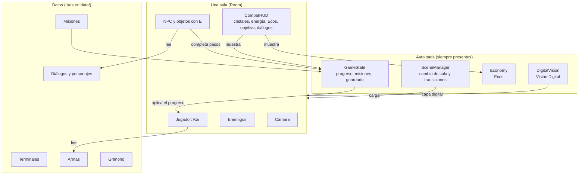

# Cómo está construido Nullveil

Guía de la arquitectura y la estructura del proyecto (actualizada al 12 de octubre de 2026). Explica **qué piezas
hay, dónde están y cómo se conectan**. Los detalles técnicos de cada sistema están en `arquitectura.md`; el combate y
la historia en `combate.md`; el plan del MVP en `plan_mvp.md`; el currículo en `curriculo_mep.md`.
La historia, los personajes y el mundo se rigen por la **Biblia Narrativa** (`narrativa/BIBLIA_NARRATIVA.md`).

## 1. En pocas palabras

| | |
|---|---|
| Motor | Godot **4.7.2**, lenguaje **GDScript**, renderizador **Compatibility** (funciona en PC y celulares) |
| Pantalla | Diseño a **1280×720**, horizontal; el mundo en pixel art con la cámara a **×2** |
| Plataformas | Windows y Android (después Linux, macOS, iOS, Steam) |
| Dependencias | **Ninguna**: sin plugins ni librerías externas |
| Tamaño | 98 scripts del juego (~10 500 líneas), 17 escenas, 47 recursos de datos, 25 pruebas automáticas (478 comprobaciones) |
| Equipo | Yohanncillo (dirección y programación) y Ariel (arte y programación), en la cuenta `codingraphcr` |

## 2. Las ideas que guían todo

1. **Componentes pequeños y reutilizables.** Un enemigo nuevo no se programa de cero: hereda de `EnemyBase`. Una
   terminal nueva no lleva código: es un recurso `TerminalChallenge` y una `TerminalStation` en la sala.
2. **El contenido son datos (`.tres`), no código.** Diálogos, misiones, terminales, armas, personajes y páginas del
   Grimorio se crean y editan en el **Inspector** de Godot.
3. **Señales para avisar, no referencias cruzadas.** Por ejemplo, el enemigo emite `died` y el combate lo escucha;
   el enemigo no sabe nada del combate.
4. **Pocos autoloads** (piezas globales): solo cinco. El resto vive en cada sala.
5. **Todo se ve en el editor** (`@tool`): pop-ups, trampas, terminales y barreras se dibujan mientras se diseña el nivel.
6. **Identificadores estables** (`contrasena_profesor`, `cambiar_contrasena`, `pc_profesor_cuenta`) para el guardado.
7. **Nada se da por bueno sin probarlo:** cada sistema tiene su prueba automática.

## 3. Cómo encajan las piezas



## 4. Estructura de carpetas

```
schoolgame/
├── autoload/          Las 7 piezas globales (SceneManager, GameState, DigitalVision, Economy, SaveManager, World, Profiles)
├── characters/        Personajes
│   ├── player/          Kai: movimiento, daño, combate, curación, sonidos y su dibujo (kai/)
│   ├── enemies/         EnemyBase y cada enemigo (weak_password/ = la «Contraseña débil»)
│   └── npcs/            NPC con conversaciones por paso de misión (profesor/)
├── components/        Piezas que se agregan a cualquier cosa
│   ├── combat/          Vida, zonas de golpe (Hitbox/Hurtbox), datos del golpe, datos de armas
│   ├── interaction/     Interactable: el aviso "E: …"
│   └── visual/          VectorCanvas: dibujo vectorial animado
├── systems/           Sistemas sin escena propia
│   ├── audio/           Sfx (efectos) y Music (música)
│   ├── dialogue/        Dialogue y DialogueCharacter
│   ├── economy/         EconomyConfig: valores de los Ecos para equilibrar
│   ├── challenges/      Desafíos de elección (preguntas con opciones y explicaciones)
│   ├── grimorio/        GrimorioEntry (una página del Grimorio)
│   ├── incidents/       Incidentes, pistas y controles de seguridad (sistema de decisiones de Ariel)
│   ├── quests/          Misiones, pasos, registro de misiones y disparadores
│   ├── security/        Reglas de contraseñas seguras (medidor, frases sugeridas, códigos de respaldo)
│   ├── settings/        GameSettings (opciones del jugador, guardadas en user://ajustes.cfg)
│   ├── terminal/        Terminal simulada: sistema de archivos ficticio e intérprete de comandos
│   └── world/           Mapa: fichas de sala (RoomTemplate, DoorSpec), distritos fijos (DistrictLayout) y el grafo (RoomGraph)
├── ui/                Interfaz
│   ├── hud/             CombatHUD: cristales, energía, Ecos, objetivo, avisos, títulos
│   ├── dialogue/        Caja de diálogo estilo Hades con retratos y voces
│   ├── menus/           Menú principal, Opciones y Grimorio
│   ├── terminal/        Ventana de la terminal
│   ├── challenges/      Ventanas de los desafíos de elección y de crear una contraseña
│   ├── equipment/       Tarjeta "NUEVO EQUIPAMIENTO DESBLOQUEADO"
│   ├── transitions/     Pantalla de carga
│   └── theme/           Tema visual común
├── world/             El mundo
│   ├── rooms/           Room (base de toda sala), entradas y salidas
│   ├── zones/           Las salas reales: zone0/ (colegio) y pc_profesor/ (dentro de la PC)
│   ├── digital/         Piezas del mundo digital: SPAM, terminal, punto de restauración, barrera
│   ├── vision/          Lo que se ve con la Visión Digital (red, puentes de datos, fragmentos)
│   ├── effects/         Efectos: succión por la pantalla, destellos, píxeles, aparición de Nullblade
│   ├── pickups/         Ecos (la moneda) y cofres
│   ├── hazards/         Peligros (pinchos)
│   └── camera/          Cámara del juego
├── data/              Contenido editable (.tres): diálogos, personajes, misiones, terminales,
│                      armas, Grimorio, incidentes
├── assets/            Arte (de Ariel), audio, fuentes y shaders
├── tests/             25 pruebas automáticas + una sala gris solo para pruebas (fixtures/)
├── tools/art/         Herramientas para recortar el arte de las hojas de concepto de Ariel
├── prototypes/        Muestras de estilos visuales (no forman parte del juego)
└── docs/              Documentación del proyecto (la historia, en docs/narrativa/)
```

## 5. Las piezas globales

| Pieza | Tipo | Qué hace |
|---|---|---|
| `SceneManager` | Autoload | Cambia de sala con transición, recuerda por qué entrada se llega (`go_to_room`) |
| `SaveManager` | Autoload | Guarda y continúa la partida (archivo con copia de respaldo); se guarda en las computadoras seguras |
| `Profiles` | Autoload | Cuentas en el servidor (`server/`): inicio de sesión y la partida cifrada de cada una |
| `World` | Autoload | El mapa: los grafos de los distritos y en qué sala está Kai; dice a dónde lleva cada puerta |
| `Economy` | Autoload | Saldo de **Ecos** (la moneda): sumar, gastar, si alcanza y la penalización al morir (10 %, máx. 100, nada en el tutorial) |
| `GameState` | Autoload | Todo el progreso: misiones, cristales, energía, habilidades, etapas de Nullblade/Aegis/Dominio, comandos aprendidos, marcas de la historia, incidentes. Sabe convertirse a datos para guardar (`to_dict` / `from_dict`) |
| `DigitalVision` | Autoload | Estado de la Visión Digital: lista, activa (10 s) o recargando (16 s), y el glitch involuntario del prólogo |
| `GameSettings` | Clase estática | Volumen, pantalla completa, velocidad del texto, reducir glitch y teclas |
| `Sfx` y `Music` | Clases estáticas | Efectos y música. Si falta el archivo de audio, generan un sonido provisional por código |
| `HitStop` | Clase estática | Congela la acción unos milisegundos al golpear o recibir un golpe |

## 6. Los sistemas, uno por uno

### Salas y transiciones
Cada sala es una escena con `Room` en la raíz: calcula los límites de la cámara, coloca a Kai en la entrada correcta,
le aplica el progreso, decide dónde reaparece si muere (`checkpoint`) y define música, pasos y color de Kai
(celeste dentro de la computadora). Las salidas (`RoomExit`) y entradas (`RoomEntry`) conectan salas.
**Salas actuales:** Entrada del colegio → Pasillo → Laboratorio → Escritorio de la PC del profesor (nivel de SPAM).

### Kai, el jugador
El nodo `Player` mueve a Kai (coyote time, salto variable, dash, doble salto, pared) y tiene nodos hijos, cada uno
con un trabajo:

| Nodo | Trabajo |
|---|---|
| `Health` | Cristales de integridad (4) |
| `Hurtbox` | Recibe golpes |
| `Damage` (`PlayerDamage`) | Reglas de daño estilo Hollow Knight: medio cristal por golpe enemigo, invulnerabilidad, empuje, volver al suelo seguro, muerte |
| `Combat` (`PlayerCombat`) | Ataque con **J** según el arma equipada (`WeaponData`). Cada golpe recupera energía |
| `Heal` (`PlayerHeal`) | Curación manteniendo **L** con la energía |
| `Sounds` | Pasos, saltos, golpes… |
| `Visual/Body/Kai` (`KaiVisual`) | El dibujo de Kai con el arte de Ariel y sus animaciones |

### Combate y enemigos
Todo el daño del juego viaja igual: un **`HitboxComponent`** (lo que golpea) crea un **`HitData`** (daño, tipo de
amenaza, empuje) que recibe un **`HurtboxComponent`** y descuenta un **`HealthComponent`**. Sirve para la espada, los
enemigos, los correos SPAM y las trampas.
Los enemigos heredan de **`EnemyBase`** (vida, contacto, destello, empuje, muerte en píxeles y Ecos); cada uno solo
escribe su comportamiento. Hoy existe la **«Contraseña débil»** (salta avisando; con media vida, «fuerza bruta»).

### Interacción, diálogos y NPC
`Interactable` muestra "E: …" al acercarse. Los diálogos se escriben como texto (`Nombre [expresión]: frase`) y la
caja de diálogo los muestra estilo Hades, con retratos, voces por personaje y el «???» con interferencia. Los NPC
(`Npc`) eligen qué decir según el paso de la misión.

### Misiones
Una misión (`Quest`) es una lista de pasos (`QuestStep`) con su objetivo en pantalla. `GameState` sabe en qué paso va
cada una. Los pasos se completan hablando, interactuando, entrando a una zona (`QuestTrigger`), resolviendo una
terminal o ganando un combate. Hoy: **Prólogo** y **La contraseña del profesor**.

### Terminal simulada
Comandos reales de Linux (`pwd`, `ls`, `cd`, `cat`, `help`, `clear`, `history`) sobre un **sistema de archivos
ficticio** en memoria: nunca toca la computadora real. Cada desafío es un recurso con sus archivos, objetivo y pistas.

### Grimorio
Libro con pestañas (mapa, arsenal, comandos, amenazas, conceptos, registros). Cada página es un `GrimorioEntry` en
`data/grimorio/` que se desbloquea con la historia, una habilidad o un comando usado. Se abre con **G**.

### Visión Digital
Revela una capa del mundo (red, puentes de datos, fragmentos) sin duplicar las salas. Q la activa una vez descubierta.

### Mundo digital (dentro de la PC)
Pop-ups que son plataformas (fijos, que se cierran, que se mueven), anuncios trampa, lluvia de correos SPAM que apunta
a Kai, puntos de restauración, la terminal, la barrera de combate y el ojo de la entidad que vigila.

### Decisiones de seguridad (incidentes)
Sistema de Ariel: un incidente tiene pistas y controles de seguridad con costo; las decisiones cambian el presupuesto,
la seguridad y la confianza del colegio. Está listo para usarse en los desafíos de fin de nivel.

## 7. Ejemplo: qué pasa cuando Kai da un tajo

1. El jugador pulsa **J** → `PlayerCombat` revisa que pueda atacar (tiene arma, no está curándose ni en dash).
2. `KaiVisual` muestra la preparación y el tajo de Ariel; suena el tajo.
3. La zona de golpe se activa un instante delante de Kai.
4. El `Hurtbox` del enemigo la detecta → recibe el `HitData` → su vida baja.
5. El enemigo parpadea, retrocede y suelta una contraseña débil; Kai recupera energía; la acción se congela 0,05 s.
6. Si la vida llega a 0: el enemigo emite `died`, se desintegra en píxeles y suelta Ecos; el combate lo escucha y
   avanza la misión.

## 8. Cómo agregar contenido sin programar

| Quiero… | Hago… |
|---|---|
| Un diálogo | Nuevo `Dialogue` en `data/dialogues/` y escribo las líneas |
| Un personaje que habla | Nuevo `DialogueCharacter` en `data/characters/` (nombre, retrato, color, voz) |
| Una misión | Nuevo `Quest` en `data/quests/` con sus pasos, y la registro en `QuestDB` |
| Una terminal | Nuevo `TerminalChallenge` en `data/terminals/` + una `TerminalStation` en la sala |
| Equilibrar los Ecos | Editar `data/economy/economia.tres` (rangos por enemigo, terminal, misión, depósito y la penalización) |
| Un desafío de elección | Nuevo `ChoiceChallenge` en `data/challenges/` (preguntas, opciones, cuál es correcta y por qué) |
| Un arma o etapa de Nullblade | Nuevo `WeaponData` en `data/weapons/` |
| La ficha de una sala para el mapa | Nuevo `RoomTemplate` en `data/world/rooms/` (tamaño en celdas, puertas con su lado, celda, clase y entrada) |
| Una página del Grimorio | Nuevo `GrimorioEntry` en `data/grimorio/` |
| Un nivel de plataformas digital | Arrastrar pop-ups, trampas, lluvias de correo y puntos de restauración a la sala |

## 9. Referencia rápida

**Controles:** A/D moverse · Espacio saltar · J atacar · L curar · Shift dash · Q Visión Digital · E interactuar ·
G Grimorio · K Aegis · R Dominio Nulo · F plataforma de Aegis (las tres últimas, para más adelante). Se cambian en
Opciones.

**Capas de colisión:** 1 mundo · 2 jugador · 3 enemigos · 4 ataques del jugador · 5 ataques enemigos · 6 interactuables
· 7 mundo digital.

**Pruebas:** 25 archivos en `tests/` (478 comprobaciones). Cada uno se corre con
`godot --headless --path . --script res://tests/test_<nombre>.gd` y termina en `RESULTADO: TODO OK`. Esperan a que
pasen las cosas (en vez de tiempos fijos) para no fallar cuando la computadora está ocupada.

**Git:** `main` es la versión común. Ariel trabaja en ramas `feature/*`; después de cada tarea se combinan y todas las
ramas quedan en el mismo commit.

## 10. Estado actual y lo que falta

**Hecho:** movimiento completo, salas y transiciones, prólogo (Visión involuntaria y la entidad «???»), entrar a la
PC, nivel de SPAM de 3360 px, terminal, combate contra la «Contraseña débil» (con el destello de la Nullblade),
la contraseña que crea el jugador (se guarda solo su huella), la verificación en dos pasos que desbloquea la Visión Digital, curación, energía, Ecos,
Grimorio, opciones, sonido provisional y voces.

**Falta para el MVP:** H5 (invitación del profesor, desafío Visión Digital + terminal, cuarto viejo con la
Nullblade oficial, dash, doble salto y «EL DESPERTAR»), controles táctiles, exportar a Windows y
Android, pruebas en celular.

## 11. Observaciones y riesgos

- **Rendimiento del escritorio de la PC:** es la sala más pesada. Con ventana corre a unos **20 cuadros por segundo**
  en nuestra computadora (la Entrada, a 60). Viene del nivel de SPAM: decenas de dibujos vectoriales animados que se
  redibujan en cada cuadro. Antes de probar en Android hay que optimizarlo (por ejemplo, dibujar una vez lo que no se
  mueve y animar solo lo necesario).
- **`GameState` crece rápido** (unas 470 líneas). Por ahora está bien; si sigue creciendo conviene separarlo por
  temas (misiones, jugador, conocimiento).
