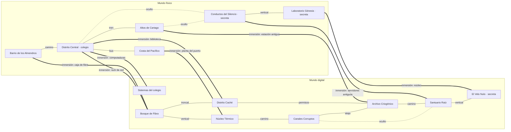

# Mapa maestro del mundo

> Documento de referencia de la arquitectura del mundo de *Nullveil: Beyond the Firewall*. Detalle en
> `REGIONES_FISICAS.md`, `BIOMAS_DIGITALES.md` y `CONEXIONES_Y_ACCESOS.md`. Historia: `../narrativa/BIBLIA_NARRATIVA.md`.

**Etiquetas de estado** (en todos los documentos de `docs/mundo/`, `docs/misiones/`, `docs/criaturas/` y
`docs/progresion/`):

| Etiqueta | Significado |
|---|---|
| **CONFIRMADO** | Decisión aprobada por el equipo (especificación del 15 de octubre de 2026, Biblia Narrativa). |
| **PROPUESTO** | Idea de diseño todavía modificable (nombres provisionales, ubicaciones, conexiones). |
| **FUTURO** | Contenido planificado que no existe en el juego. |
| **IMPLEMENTADO** | Existe y se puede jugar (con prueba automática que lo comprueba). |

## 1. Filosofía (CONFIRMADO)

Dos mundos interconectados, los dos importantes para la historia:

- **Mundo físico:** la vida cotidiana de Kai, sus relaciones, el colegio, su familia y los secretos de su pasado.
  **Es real** (el colegio y la familia de Kai son reales): nunca habrá un giro de «todo era una simulación».
  Tiene incidentes y encuentros especiales solo cuando la historia lo justifica; las calles no son un campo de batalla.
- **Mundo digital:** sistemas, conexiones, información, amenazas y las consecuencias de las decisiones de sus
  creadores y habitantes. Más criaturas, combate y plataformas. Aegis y Axiom participaron en la creación y
  organización de sus regiones; **Kai no**.

Los dos tienen exploración, rutas alternativas, secretos, NPC y actividades. Inspiración solo de principios
generales de diseño: no se copian mapas, personajes, nombres, diseños ni música de otros juegos.

**Principio:** un mundo grande no necesita cientos de personajes; necesita regiones memorables, mecánicas
coherentes y consecuencias significativas.

## 2. Regiones

### Mundo físico (inspirado en Costa Rica; geografía ficticia, culturalmente reconocible)

| Región | Id | Inspiración | Estado |
|---|---|---|---|
| Barrio de los Almendros (nombre provisional) | `barrio_almendros` | Barrios residenciales | **IMPLEMENTADO** en parte: la calle, la casa y el cuarto de Kai (distrito `barrio`) |
| Distrito Central | `distrito_central` | San José | **IMPLEMENTADO** en parte: el colegio (distrito `colegio`). La ciudad: FUTURO |
| Altos de Cartago | `altos_cartago` | Cartago | FUTURO |
| Costa del Pacífico | `costa_pacifico` | Puntarenas | FUTURO |
| Los Conductos del Silencio (nombre provisional, secreta) | `conductos_silencio` | — | FUTURO |
| Laboratorio Génesis (secreta) | `laboratorio_genesis` | — | FUTURO |

### Mundo digital

| Región | Id | Conceptos | Estado |
|---|---|---|---|
| Sistemas del colegio (sistemas locales, no es un bioma) | `sistemas_colegio` | Entornos de práctica controlados | **IMPLEMENTADO**: red de entrenamiento (Cap. 1), simulador (Cap. 2), PC del profesor |
| Bosque de Fibra | `bosque_fibra` | Redes, conectividad, transmisión | **IMPLEMENTADO** (MVP): sector introductorio de 2 salas |
| Distrito Caché | `distrito_cache` | Accesos y permisos, comercio de Ecos | FUTURO |
| Núcleo Térmico | `nucleo_termico` | Procesamiento, automatización, recursos | FUTURO |
| Archivo Criogénico | `archivo_criogenico` | Almacenamiento, integridad, respaldos | FUTURO |
| Canales Corruptos | `canales_corruptos` | Malware, detección, contención | FUTURO |
| Santuario Raíz | `santuario_raiz` | Privilegios, autorización, identidad | FUTURO |
| El Velo Nulo (secreta) | `velo_nulo` | Integración de habilidades, conflictos finales | FUTURO |

**Sobre los sistemas del colegio (PROPUESTO):** la red de entrenamiento y el simulador del Capítulo 1 y 2 son
entornos locales y controlados del colegio, no parte de la red de biomas. Por eso se agrupan aparte: así no
se contradice lo ya jugable y los biomas siguen siendo un universo propio.

## 3. Grafo de conexiones (resumen)

- **No es lineal:** el Bosque de Fibra se une al Distrito Caché **y** al Núcleo Térmico; del Núcleo se llega a los
  Canales y de ahí al Archivo por un atajo, sin pasar por el Distrito Caché. Al Santuario se llega por el Archivo,
  por una grieta oculta desde los Canales o desde los Conductos del Silencio.
- **Horizontales y verticales:** caminos, conexiones verticales (raíces, ascensor, la puerta del Velo), atajos
  (al restaurar un sistema) y pasajes ocultos (se ven solo cuando se pueden usar).
- **Regresos:** todas las conexiones son de ida y vuelta (salvo las que se marquen `one_way`); las regiones se
  revisitan con aprendizajes nuevos (`../progresion/MATRIZ_MEP_Y_CAPITULOS.md`).

Lista completa con requisitos: `CONEXIONES_Y_ACCESOS.md`. Datos: `data/world/regions/` y `data/world/links/`.

## 4. Arquitectura técnica (IMPLEMENTADO)

| Pieza | Archivo | Qué es |
|---|---|---|
| `WorldRegion` | `systems/world_map/world_region.gd` | Una región (física o digital): id, nombre, conceptos, distritos de World, secreta, lugar en el mapa |
| `RegionLink` | `systems/world_map/region_link.gd` | Una conexión entre regiones: tipo, dispositivo o lugar (`access_point`), para qué existe, requisito |
| `WorldRequirement` | `systems/world_map/world_requirement.gd` | Requisito reutilizable: capítulo, marcas, misiones terminadas, habilidades |
| `WorldAtlas` | `systems/world_map/world_atlas.gd` | Registro de regiones y conexiones; qué sabe el jugador de cada una (desconocida, niebla, descubierta, visitada) |
| `World` (ya existía) | `autoload/world.gd` | Distritos y salas jugables (grafo de salas), salas visitadas; ahora avisa «Región descubierta» |
| Grimorio | `ui/menus/grimorio/` | Mapa de la zona (ya existía) + mapa del mundo físico y del digital + bestiario |

**Capas:** región (`WorldRegion`) → distrito (`DistrictLayout`, ya existía) → sala (`RoomTemplate`, ya existía).
Una región sin distritos existe en el mapa (con niebla) pero todavía no en el juego.

**Persistencia:** nada se guarda en los recursos. Lo que sabe el jugador sale de la ranura activa: salas
visitadas (`World.visited`), marcas (`region_visitada_<id>`, `region_descubierta_<id>`, `bestiario_<id>_<etapa>`,
marcas de misiones y de sistemas restaurados) y el progreso de las misiones. Cada ranura tiene lo suyo.

## 5. Grimorio y cartografía

- **Mapa de la zona** (IMPLEMENTADO desde antes): las salas del distrito donde está Kai, con sus estados.
- **Mapa del mundo físico** y **mapa del mundo digital** (IMPLEMENTADO): regiones con niebla de exploración,
  regiones descubiertas y visitadas, conexiones conocidas (las que todavía no se pueden usar, con candado), dónde
  está Kai y a dónde ir por la misión. Las secretas (Conductos del Silencio, Laboratorio Génesis, El Velo Nulo)
  **no aparecen** hasta descubrirlas. El dibujo es una cuadrícula de bloques propia (no imita la silueta de otros
  juegos).

## 6. Viaje rápido: Salto de Nexo (CONFIRMADO, FUTURO)

Se desbloquea **al final de décimo** (después del nivel 8 y de la misión «Los nodos olvidados»; Biblia, sección
V). Solo entre nodos **visitados físicamente y activados**; algunos necesitan reparación con Ecos. Antes, todo se
recorre por rutas normales. No es una evolución de Aegis. Los nodos se definirán como datos cuando se implemente.
